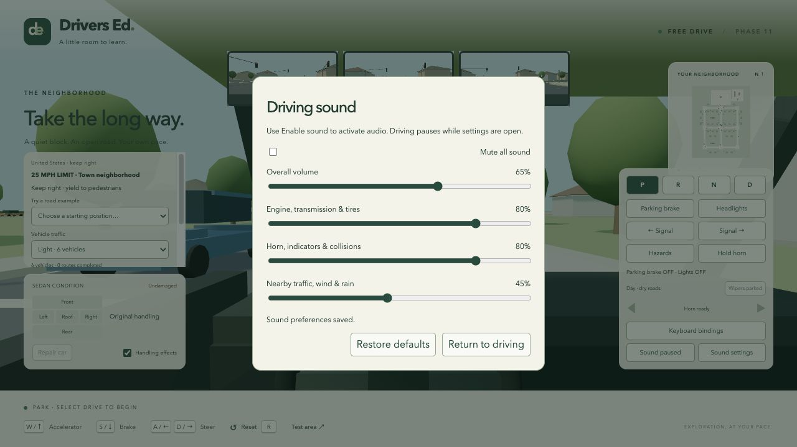
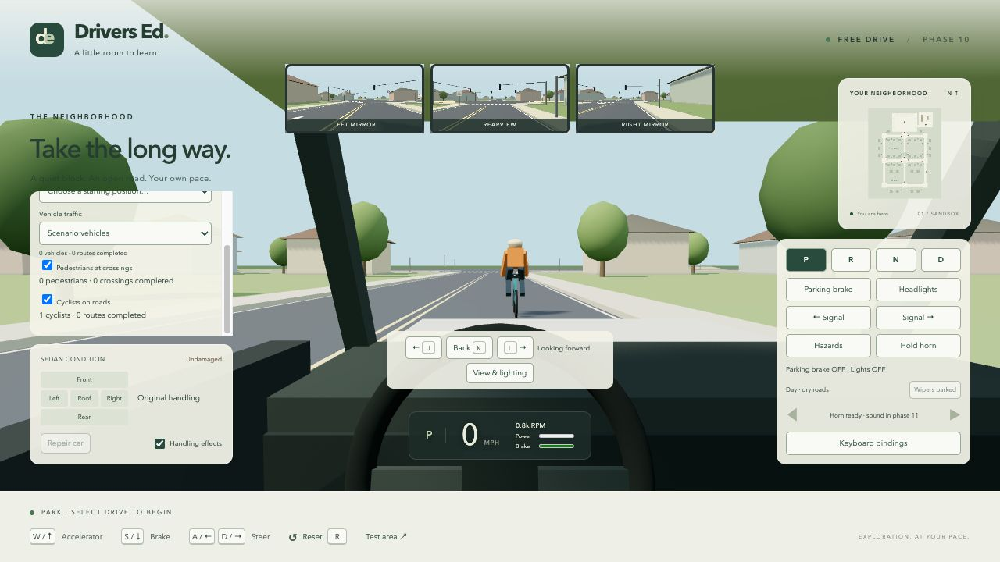

# Drivers Ed

A browser-based, first-person driving sandbox built with TypeScript and WebGL through Three.js. Phase 11 adds procedural engine, transmission, tire/surface, horn, indicator, impact, scrape, nearby traffic, wind, and rain audio with saved volume controls. Configurable day/dusk/night, shadowed headlights, rain, wet-road grip, visibility, and windshield wipers remain available. Crossing pedestrians and lane-riding cyclists share vehicle yielding, repeatable encounters, and finite-mass collisions on the US road network. The Rapier sedan retains shoulder/rear checks, three rear-facing mirrors, adjustable seating/FOV, camera comfort settings, and engine/brake instruments.



## Run locally

Requires Node.js 22.18+ (or Node.js 24) and npm.

```sh
npm install
npm run dev
```

Open the local URL printed by Vite (normally http://127.0.0.1:5173).

```sh
npm run build   # Type-check and create a production build in dist/
npm run preview # Serve the production build locally
npm test        # Driving and world-layout tests using Node's built-in runner
npm run handling:check # Repeatable flat-road handling measurements
```

Use a browser with WebGL 2, WebAssembly, and hardware acceleration enabled. All scenery is generated locally; the game loads no external models, textures, or fonts. Rapier's WebAssembly is bundled with the application. Its compatibility package increases the production download size; Vite currently reports a large-bundle advisory.

## Controls

| Input | Action |
| --- | --- |
| W / Up | Accelerator in the selected Drive or Reverse gear |
| S / Down | Service brake; takes priority over the accelerator |
| A / Left, D / Right | Steer |
| 1 / 2 / 3 / 4 | Select Park / Reverse / Neutral / Drive |
| B | Toggle parking brake |
| Q / E | Toggle left / right indicator; selecting the other side replaces it |
| X | Toggle hazard lights |
| H | Toggle headlights |
| Space (hold) | Horn control with visible feedback and sound after audio activation |
| Enable sound / Sound on / Sound muted button | Activate browser audio, then toggle mute; activation requires a click/tap each page load |
| Sound settings button | Pause driving to adjust overall, vehicle, effects, and environment volume, or mute all sound |
| R / Reset button | Return to the starting position in Park |
| Keyboard bindings button | Remap controls, or restore defaults |
| J / L (hold) | Check left / right shoulder; release to face forward |
| K (hold) | Look back through the rear window; release to face forward |
| Shoulder / Back buttons (hold) | Pointer, touch, or focused Space/Enter head checks |
| View & lighting button | Select Day / Dusk / Night, Dry / Rain, and Off / Slow / Fast wipers; adjust seating, field of view, head-turn smoothing, chassis motion, and mirror quality |
| Wipers button | Cycle Off / Slow / Fast while driving in rain; blades park in Dry |
| Try a road example selector | Reset in Park before signals, a stop/yield junction, or parallel parking; restart the signal cycle |
| Traffic examples in the road example selector | Repeat following/signals, simultaneous stops, a permissive left turn, a yield encounter, or a collision with fixed traffic starts |
| Pedestrian examples in the road example selector | Repeat crossing/yielding, partial occlusion, or failure to yield with fixed starts |
| Pedestrians at crossings checkbox | Enable/reset three crossing pedestrians, or remove them in place |
| Cyclists on roads checkbox | Enable two seeded lane-riding cyclists, or remove their riders and bicycles in place |
| Vehicle traffic selector | Off, a single vehicle, Light (up to 6), or Busy (up to 16); changes traffic in place |
| Test area button | Reset upright on the approach to the suspension test ramp |
| Repair car button | Restore appearance and handling in place, preserving position and motion |
| Handling effects checkbox | Enable/disable damage-related handling changes; body damage remains visible |

The car starts in **Park**. Select **Drive (4)**, then hold **W** to accelerate. Stop with **S**, select **Reverse (2)**, then use **W** to back up. The brake always wins when both pedals are held. Releasing steering centers the wheel; releasing the accelerator permits coasting with engine braking in Drive/Reverse. Forward ratios shift automatically, with D1/D2/D3… shown on the speed display; there are no manual gears or automatic creep.

Park and engagement of Drive/Reverse require a complete stop (below 0.03 m/s, allowing small suspension jitter). Unsafe selections are rejected with a notice and must be requested again after stopping. Drive/Reverse engagement has a 0.35-second power interlock. **Neutral (3)** can be selected while moving and allows coasting without propulsion. **Park (1)** holds the wheels. The separate parking brake also holds the wheels and cuts propulsion while engaged; it can be applied while moving and stays on until toggled off.

On-screen gear and switch buttons work with mouse or touch. Touch devices also have accelerator, brake, and steering pedals. Hold the horn or head-check buttons with a pointer, or focus them and hold Space/Enter. Keyboard bindings shows every default and supports reassignment to letters, numbers, arrows, Shift, or Space; a conflicting binding is rejected. Assigning a new key replaces that action's default aliases. Bindings persist locally when browser storage is available, and invalid saved data falls back to defaults. Older Phase 5 bindings migrate while preserving remaps; if J/K/L are already used, free keys are assigned to the new head checks and shown on their buttons. Buttons and touch controls remain available after remapping. Analog controllers are deferred until requested.

Window blur, hidden-page transitions, opening settings, and graphics interruption clear held pedals, steering inputs, and the horn and pause motion. Returning resumes with released controls. Focusing a form/button clears held inputs; pointer cancellation or lost capture releases its individual input. Deliberate gear, parking-brake, headlight, and indicator selections survive ordinary interruptions. Reset and Test area start in Park with switches off; Repair car preserves their state. Free driving remains available throughout.

## Phase 1

- A generic, unstyled sedan with a fixed driver's-seat camera, a plain dashboard, and a steering wheel.
- A 200 × 120 metre rectangular road loop, with a central street connecting the two longer sides. Streets are 10 metres wide.
- Placeholder houses, trees, sidewalks, lawns, and a visible hedge boundary.
- Forward/reverse acceleration, braking before direction changes, steering, and drag. Phase 2 refines this handling and raises the forward speed limit; grass and reverse remain slower.
- A sedan-sized collision footprint against houses, tree trunks, and the outer boundary.
- A small live map, speed and direction display, and reset control.

For turning practice, drive straight ahead from the starting position along the center street. Cross the north T-junction into the wide parking-lot entrance, marked **P** on the map. The lot is 120 × 90 metres, with a 16-metre entrance, perimeter parking spaces, and a large clear center for circles and figure eights. Both the entrance and lot have normal asphalt grip. The outer hedge boundary sits beyond the lot.

## Phase 2 — Implemented handling

The reference vehicle is a fictional 1,500 kg sedan, 4.5 m long and 1.8 m wide, with a 2.7 m wheelbase and 0.31 m tire radius. These are authored tuning values, not specifications or measured validation for a real car. Vehicle configuration is independent of the renderer.

- Progressive throttle and brake response, engine torque, rolling resistance, aerodynamic drag, and engine braking.
- Six available automatic forward ratios and a reverse ratio, with shift hysteresis, brief power interruptions during shifts, and first-gear selection for launch. Sustained high-speed driving uses all six forward ratios.
- A complete-stop interlock and 0.35-second selection delay in the original direction-key interface. Phase 5 replaces browser direction keys with explicit P/R/N/D selection and separate accelerator/brake pedals. There is no automatic creep.
- Rate-limited steering. Full steering lock stays available at every speed and remains held while a direction key is down. Speed reduces how quickly steering builds, rather than unwinding the held wheel; releasing the key centers it.
- Grip-limited handling. Phase 3 now applies tire forces at each suspension contact, replacing the original planar turn limiter.
- A 115 mph forward governor, with a measured sustained speed around 112.5 mph after drag and rolling resistance. Reverse remains limited to about 11 mph, with slower driving and greater resistance on grass.

The current measurements below use the same Rapier vehicle and explicit controls as the browser, starting acceleration timing at Drive selection, on an obstacle-free flat test pad in code. The neighborhood's short streets do not provide room for a full top-speed run. The stopping test starts applying the brakes at 30 mph and excludes human reaction time. The turning measurement follows the car's center path at approximately 1 m/s, rather than measuring an outer-wheel or body turning circle. Full steering lock does not guarantee a tight turn at speed: tire grip limits the trajectory.

| Check | Acceptance target | Current measurement |
| --- | --- | --- |
| 0–30 mph acceleration | 5–7 s | 5.42 s |
| 30–0 mph stopping distance | 12–17 m | 12.32 m |
| 30–0 mph stopping time | 1.5–2.2 s | 1.77 s |
| Speed after 5 s coasting from 30 mph | 22–26 mph | 23.52 mph |
| Low-speed full-lock center-path radius | 4.8–5.7 m | 5.34 m |
| Sustained speed after 180 s at full throttle | 110–115 mph | 112.45 mph |
| Same timed rigid-body maneuver at 30/60/144 Hz | Identical resulting position, orientation, and speed | Pass |

Run `npm run handling:check` to reproduce the measurements and `npm test` to check their acceptance bounds, held-steering behavior, direction transitions, transmission behavior, grip limits, braking and obstacle collisions from 115 mph, collision recovery, and frame-rate consistency.

## Phase 3 — Suspension, ground contact, and collisions

- A dynamic 1,500 kg chassis runs at 120 Hz with four raycast suspension contacts. Each wheel has spring travel, compression/rebound damping, contact-dependent drive/brake forces, and lateral friction.
- The cockpit follows the physical body, so slopes, bumps, acceleration, and braking can produce pitch and roll. Wheel positions follow suspension travel; front wheels steer visually and physically.
- Gravity acts on slopes and while airborne. Airborne wheels cannot propel the vehicle. Holding both direction keys applies the brakes to hold a shallow slope; releasing them permits gravity-driven rollback.
- Houses, tree trunks, hedges, pavement, and sidewalks have 3D colliders. Glancing impacts retain tangential movement instead of forcing a complete stop. Continuous collision detection is enabled on the chassis and is tested against a thin wall at 115 mph.
- Sidewalks now have actual 15 cm raised edges. Their geometry is cut around intersections, lot entrances, and driveways so those routes remain flush. Rendering and collision construction share the same layout dimensions.
- Reset clears the chassis, wheel controller, motion, and pending controls, then settles a fresh suspension at a known safe spawn. An overturned car displays a recovery hint. **R** returns to the neighborhood start; **Test area** places the car before the ramp.

The **T** area is east of the parking lot, connected through its southeast side. It contains a 10 m-wide ramp with a 1.2 m rise, shallow 12 m approaches and an 8 m plateau, plus a separate 15 cm raised curb pad. Approach slowly to observe pitching over the ramp or drive one side of the car over the curb pad to observe roll. The original parking lot stays open for turning practice.

Rapier was selected for its [raycast vehicle controller](https://rapier.rs/javascript3d/classes/DynamicRayCastVehicleController.html) and [continuous collision detection](https://rapier.rs/docs/user_guides/javascript/rigid_body_ccd/), avoiding a custom 3D contact solver. The current implementation is still a simplified sedan: wheel contacts are rays rather than deformable tire shapes; all four contacts share drive force; there is no detailed tire model, suspension linkage geometry, crash deformation, or validated real-car calibration. Very sharp edges and extreme maneuvers may produce simplified responses. Use Reset if the car becomes stuck or overturned.

The test suite checks flat-ground settling, performance targets, held steering and reverse transitions, the drive-in route, ramp ascent/descent, braking on a slope, asymmetric curb traversal, airborne contact loss and landing, glancing impacts, high-speed wall collision, repeated recovery, and deterministic frame-rate behavior. Phase 2's planar model remains only as an isolated controls/drivetrain reference; the browser uses the Rapier model. Vehicle traffic, pedestrians, cyclists, and audio are described below; objectives and detailed vehicle art remain future work.

## Phase 4 — Car damage and repair

- Rapier contact-force events supply contact locations and normals. Inward contact-point speed determines impact severity; tangential movement accumulates scratches by distance. Front, rear, left, right, and roof damage persist until repair or reset during the current session.
- Impacts below 1.2 m/s inward speed are ignored. Light impacts cause cosmetic damage; impacts at 5 m/s and above can weaken the closest wheel's suspension. A contact latch, a 0.3-second impact cooldown, and a solver-impulse threshold reject resting-force damage. Driving back into an obstacle after bouncing away counts as another impact.
- Separate placeholder body panels show shallow dents, darker damaged paint, and scratches. The hood is visible from the driver's seat; the dashboard diagram reports damage to every panel, with dent/scratch percentages available on hover and to assistive technology.
- Heavier frontal dents can reduce propulsion by at most 35%. Wheel damage can introduce up to 0.055 radians of steering bias and reduce spring/damping strength by at most 25%. These authored effects remain bounded, preserve braking, and leave the car driveable. Dashboard feedback describes the active effects.
- **Handling effects** disables the physical penalties immediately on the next simulation step while retaining cosmetic damage. Tests and tools can also pass `damageHandling: false` to `createVehiclePhysics` for the undamaged handling baseline.
- **Repair car** restores panels and wheel settings in place without moving or stopping the car. **Reset / R** and **Test area** restore an undamaged car at their safe spawn and preserve the handling-effects setting.
- `physics.damage.drainEvents()` exposes bounded impact and scrape-start/update/end events with simulation time, panel, severity, world contact point, normal, and obstacle material. Scrape updates are limited to one per 0.25 seconds per obstacle. Pause ends active scrapes; repair and reset discard pending impacts and emit end events for any active scrape. The browser consumes these events for notices; no audio is introduced in this phase.

The acceptance checks cover proportional light/heavy damage, front/rear/side location, glancing scrapes, repeated impacts, sustained resting contact with the accelerator held, stable maximum handling penalties, baseline equivalence with penalties disabled, repair/reset, restoration of original panel geometry/materials, and identical damage/events/vehicle state at 30/60/144 Hz. Earlier driving and terrain checks remain passing.

This is a game damage model, not crash deformation or a real vehicle safety/calibration model. Dents affect appearance without changing collision shapes. Wheel damage is localized to the strongest sampled contact; detailed structural damage, detached parts, broken glass, finished art, and saving damage across page reloads are outside this increment.

## Phase 5 — Driver controls

- Explicit P/R/N/D selection retains automatic forward shifting. The accelerator follows the selected gear; the service brake never selects reverse. Brake overlap, unsafe moving selections, Neutral coasting, and the engagement delay have repeatable tests.
- Park and the toggled parking brake use simplified wheel braking on all four wheels. The parking brake cuts propulsion immediately and remains effective with handling damage. Both hold the existing 1:10 test slope within 15 cm over eight seconds. This increment does not model a transmission pawl or a rear-axle handbrake/drifting system.
- Left/right indicators and hazards blink on a one-second simulation-time cycle (half on, half off), visible on placeholder front/rear lamps and dashboard arrows. Indicators cancel when toggled again or replaced by the other side; automatic cancellation is deferred. Headlights switch emissive lenses and two forward spotlight beams; Phase 10 adds dusk and night lighting with shadowed beams.
- The horn has a momentary held state and visible dashboard feedback. Phase 11 adds a held two-tone horn and indicator clicks after audio activation.
- Keyboard and pointer sources are tracked independently. Key repeat cannot repeatedly toggle a switch; opposing steering cancels. Blur, visibility, settings, form focus, pointer cancellation, and lost capture clear the appropriate held controls. Switches persist across ordinary interruptions. No gamepad polling is introduced until analog controller support is requested.
- The keyboard dialog lists all bindings, pauses the simulation, rejects conflicts and reserved keys, persists versioned preferences locally, and restores defaults. Reset clears operating controls; repair preserves them.

Acceptance checks cover safe forward/reverse transitions, Park/Neutral propulsion lockout, braking priority, parking-brake stop/release and slope hold, overlapping device inputs, repeat suppression, interruption cleanup, binding conflicts and corrupt saved preferences, switch timing, repair/reset, and identical state at 30/60/144 Hz. The prior handling, terrain, collision, and damage regressions remain in the suite. Browser smoke checks cover gear selection and rejection, brake and switch feedback, remapping across reload, and desktop/phone-sized layouts.

## Phase 6 — Cockpit visibility and instruments (first increment)

- The driver remains in the left seat, with adjustable eye height (1.12–1.38 m), distance back (0.18–0.55 m), and vertical field of view (55–90°, default 68°). The bounds keep the eye inside the placeholder cabin. The default seating position preserves the earlier forward view and visible hood for lane/parking judgment.
- Hold **J/L** for a 117° left/right shoulder check, or **K** for a rear-window check. Release to face forward. Opposing shoulder inputs cancel; Back takes priority, with a held shoulder choosing which way to turn. Head turns are independent of steering and gear. All three controls can be remapped, or held using the on-screen pointer/touch buttons. Focus loss, settings, reset, pointer cancellation, and lost capture release head inputs along with existing driving controls.
- A labeled mirror strip displays an interior rearview and left/right side views from car-local mirror positions. Views are horizontally reflected, follow the physical chassis, and remain rear-facing during head checks. Side views point 17° outward and use a wider FOV than the interior mirror. They overlap the view behind the car, but adjacent blind spots require shoulder checks. The player's shell is omitted from mirror passes; these are simplified placeholder mirrors without glass optics or cabin/body occlusion.
- **View & lighting** can disable chassis pitch/roll for a level horizon, or disable animated head turns for instant checks. The seat still follows the physical car's position; no extra shake is introduced. Preferences save locally with validation and safe defaults for corrupt/older data. Reset preserves view preferences and clears the current head check. Opening either settings dialog pauses driving and releases held inputs.
- The compact instrument cluster retains MPH and P/R/N/D/automatic ratio, and adds live engine RPM, throttle, and service-brake force meters. Park uses the service-brake force meter as part of its simplified wheel hold; the separate parking brake retains its existing switch feedback. Placeholder cockpit geometry remains in place.

The initial rendering budget caps mirrors at **three 512 × 256 targets, up to 30 batches/second** (11.8 million mirror pixels/second), with **Low: 256 × 128 at up to 15 Hz**, or **Off**. Each batch renders one pass per mirror, with a 220 m far plane, no multisampling/mipmaps, and reused main-view shadows. Slow frames and resume never trigger catch-up batches. The small screen overlay reuses the latest textures between batches. This caps authored rendering work; it is not a measured GPU/frame-time guarantee across devices. Device profiling and a supported hardware frame-rate target remain to be agreed.

Acceptance checks verify both lane edges in the forward view, rear/adjacent target visibility during head checks, correct mirror direction and horizontal reflection across vehicle headings, mirror blind spots, level-horizon orientation, independent held sources and cleanup, old-binding migration, saved-view validation, and head movement/mirror scheduling at 30/60/144 Hz. All previous driving regressions remain in the suite. Browser smoke checks cover saved preferences across reload, Low/Off/default mirrors, desktop, 390 × 844 portrait, and 844 × 390 landscape layouts. Surrounding-position checks use static reference points/scenery; moving traffic still belongs to Phase 8. Mirrors currently use a screen strip; physical mirror housings, mouse/vertical free look, and broader hardware profiling remain possible follow-up work within Phase 6.

## Phase 7 — Streets and traffic rules (implemented)

The town uses **United States conventions and right-hand traffic**, as confirmed by the project owner. The southern expansion extends from Town Street (Z = 60 m) to Garden Street (Z = 180 m), with three connecting streets, a southern block, and recessed parallel parking bays. Drive south along any of the original north–south streets to reach it. The original practice lot and suspension area remain accessible.

- Shared street and junction data generates directional lanes, permitted straight/left/right connections, and turn paths with room for the sedan. Pavement, wide junction aprons, and crossing openings feed both Three.js and Rapier. Double yellow center lines, white edges, and lane arrows leave junctions clear; arrows show the movements actually available at each junction.
- **Lot crossroads:** four-way intersection with an all-way STOP on every approach, including the parking-lot exit. Stop before the white bar, then yield to earlier arrivals, the driver on your right at simultaneous arrival, pedestrians, and opposing traffic when turning left.
- **Town crossroads:** opposing north/south approaches have 14 seconds green, 3 seconds yellow, and 2 seconds all red, followed by the same sequence for east/west. The 38-second cycle runs on the vehicle's 120 Hz simulation clock, pauses with driving, and restarts on any reset or example selection. Circular green permits left turns after yielding; all four approaches have **NO TURN ON RED** signs. Yellow means stop if you can do so safely, or clear the junction if already committed.
- **Garden junction:** the Center/Garden Drive approach has a STOP; Garden Street is the through route. The Town Street branch at the west junction also has a STOP. At the **east junction**, the Town Street branch has a YIELD sign and triangular yield line; East Street is the through route.
- Marked crossings at the lot crossroads, town crossroads, and Garden junction have flush sidewalk openings. Stop bars sit 1.8 m before the near crossing edge, covering only the incoming lane. Signs face approaching drivers from the right verge. Sign and signal support posts have matching physical colliders and can damage the car when struck.
- **Speed zones:** 25 mph on the original town streets, 15 mph in the southern Garden neighborhood, and 10 mph in the lot and suspension practice area. Paired transition signs mark the southern boundary at Z = 78 m and the lot transition at Z = −76 m. Additional signs repeat the town limit. The driver display shows the current zone and the nearest control ahead, with distance measured from the front bumper; map dots match roadside signal colors.
- The practice lot has explicit 3 × 6 m and 3.2 × 6 m perpendicular spaces that generate their paint. Three north-facing 3 × 8 m parallel spaces sit on the east side of the southern East Street extension, around Z = 108–124 m. Approach northbound from the southeast bend and reverse into a bay. Houses, trees, map bounds, and the hedge boundary expand with the streets.

Use **Try a road example** to start before the town signals, lot all-way stop, Garden T-junction stop, east junction yield, or parallel parking bays. Selection resets the car undamaged in Park and restarts the signal cycle, while preserving view preferences and the damage-handling setting. The Test area and neighborhood Reset controls remain available.

The controls use familiar [FHWA MUTCD sign, marking, and signal conventions](https://mutcd.fhwa.dot.gov/kno_11th_Editionr1.htm); the stop-line spacing follows the [MUTCD marking guidance](https://mutcd.fhwa.dot.gov/pdfs/11th_Edition/mutcd11thedition.pdf), and permissive left turns follow [FHWA's signal timing guidance](https://ops.fhwa.dot.gov/publications/fhwahop08024/chapter4.htm). Signal timing, speed-zone values, and placeholder dimensions are authored demonstration choices. Phase 8 adds AI compliance; Phase 9 adds crossing pedestrians and lane-riding cyclists, and violation scoring and exercises remain Phase 13 work. The player's car is not automatically stopped at signs, restricted by signals, or governed to zone limits.

Acceptance checks cover every lane and permitted turn path with a full sedan footprint in both generated driving-side orientations, turning radii above 5.7 m, connected routes, flush crossings, parking clearance, the selected US lane orientation, signs/stop lines/speed zones, signal phase boundaries and clearance, permissive left turns, rule metadata, front-bumper guidance, example spawns, physical sign impacts, and identical signal timing at 30/60/144 Hz. Existing driving, terrain, damage, and cockpit tests remain passing. Browser checks cover each example, manual approach/braking, signal and guidance agreement, settings pause/reset, and desktop/phone/landscape layouts.

## Phase 8 — Vehicle traffic (first playable increment)

- Placeholder sedans follow the shared US lanes and sampled turn paths on the same 120 Hz clock as the player and signals. Seeded, finite routes exclude the practice lot and test area, leaving those spaces free for maneuvers. Straight-road cruising is capped at 9 m/s (about 20 mph) or the local speed limit; turns use a 5 m/s cap. Authored acceleration/braking limits are 1.8/4.5 m/s².
- Drivers look along their upcoming lane, turn, and exit for other sedan footprints and the player. A 2.5 m standstill gap and 1.6 s following headway govern braking. A stopped player or blocked exit can hold a queue; removing the obstruction lets it resume. Emergency distance clamps handle sudden player intrusion, so those stops can exceed the ordinary braking limit.
- Junction entry is deliberately cautious: every AI driver pauses before entering, including at green signals and uncontrolled bends. Stop-controlled drivers dwell for at least 0.7 s, stopping their front bumper 0.4 m behind the stop bar. All-way stops respect arrival order and the driver on the right at simultaneous arrivals; a stable tie break resolves a complete four-way priority cycle. Stop/yield branches yield to the leading through-route vehicle; permissive left turns yield to the opposing leader. Cars waiting farther back do not block a left turn independently of their leader.
- One AI vehicle reserves a junction at a time, retaining ownership until its rear clears the exit. Red/yellow deny new entry; already committed vehicles clear after the lights change. Drivers check exit space before admission and conservatively yield to a player inside or moving toward the junction. This serializes compatible movements and can produce long queues at Busy density; it is an initial predictable traffic model, not a complete human-driver model.
- **Vehicle traffic** defaults to Light, with Off / Single / Light / Busy caps of 0 / 1 / 6 / 16. Seeded spawning checks an 18 m clearance from existing cars and the player and retries once per simulation second when space is unavailable. Route completion removes the car and its collider; ordinary traffic replenishes to the selected cap. Lowering density removes excess cars and reservations immediately. Reset restarts traffic and signals deterministically; repair preserves traffic. All traffic freezes during existing settings/focus/visibility/graphics interruptions.
- The five **Traffic:** road examples reset the player in Park facing the encounter and install finite, repeatable fixtures. They display **Scenario vehicles** and do not replenish. Selecting a density returns to ordinary spawning; Reset or another road example exits the fixture (defaulting to Light). Re-select the same example to repeat it. Brake lamps, turn indicators, map markers, and all three existing mirror passes include traffic.
- Phase 8b replaces the initial kinematic colliders with dynamic sedans that can be pushed and rotated. Both cars receive localized damage; collision response and recovery are described below. Lane changes, overtaking, horn response, and evasive driving remain deferred. Parking across a junction can obstruct traffic; reset or turn traffic off to clear it.

Acceptance checks cover finite route completion and pavement alignment, following/spacing behind a stationary player and release, stop-bar clearance, red/yellow entry and committed clearance, stop dwell and simultaneous arrival ordering, permissive left turns, through-route priority, player intrusion, blocked exits, safe spawning/removal/reset, and identical outcomes at 30/60/144 Hz. A ten-minute 16-car run checks sampled oriented footprints for collisions, at least eight completed routes, and continued progress for surviving cars over its final four minutes. The test reports fixed-step AI cost on the executing host; this does not establish a browser/device frame-rate guarantee. Desktop, phone, and compact landscape browser smoke checks cover density, fixtures, rendering, and control access. Hardware profiling remains future validation.

## Phase 8b — Traffic collision response and damage (implemented)

Traffic uses finite-mass, 1,500 kg dynamic Rapier bodies in the player's world. Bounded driving forces and yaw torque let rear, side, and head-on impacts transfer momentum and rotate a sedan. The controller reads the resulting physical pose after each shared step; it never restores an old pose or overwrites impact velocity. Traffic braking includes a stopping margin for the dynamic controller.

Both participants measure damage using relative contact-point velocity and solver impulse. Each traffic car retains its own panel dents, scratches, and bounded power loss. Continuing pushes and resting contacts retain the existing damage safeguards. Damage is visible in every mirror pass; orange map markers and the traffic instrument's damaged count identify affected cars. Pooled rendering slots restore geometry and paint when reused.

After an impact, an AI driver pauses its motor for 0.8 simulation seconds, then brakes and recovers gradually toward its route at reduced speed. Following and intersection decisions use physical positions, and recovering cars inside a junction block new entry. Recovery blocked for 20 seconds retires the car and releases its reservation, colliders, and damage registration. Ordinary traffic replenishes; finite scenario vehicles do not. Pause, density changes, and reset retain their existing lifecycle behavior.

Choose **Traffic: collision and damage** in the road example selector, select Drive, and accelerate into the stopped sedan ahead to repeat a rear impact. Re-select the example to restore both cars. **Repair car** repairs only the player's sedan; traffic damage persists until that car leaves or traffic resets.

The traffic chassis is deliberately grounded: it can move horizontally and yaw, but has no wheel suspension, vertical displacement, pitch, roll, or rollover simulation. The player retains full suspension and three-dimensional chassis physics.

Acceptance checks cover proportional rear impacts, side displacement/yaw, head-on impacts, a moving AI car striking a stationary player, glancing scratches on both cars, resting-contact safeguards, gradual recovery without pose/velocity replacement, blocked recovery cleanup, pooled visual restoration, and identical collision/damage outcomes at 30/60/144 Hz. A ten-minute Busy run includes the player, up to 16 dynamic traffic cars, AI, and neighborhood physics, checks route completion without routine impacts, and reports shared-step cost (about 0.18 ms on the development host). This measurement is not a browser/device frame-rate guarantee. All 100 regression tests pass.

## Phase 9 — Pedestrians (first playable increment)

- Three placeholder pedestrians use existing flush crossing ramps at the Lot, Town, and Garden junctions. Each waits, crosses at about 1.2 m/s, pauses at the opposite curb, and walks back without teleporting. They check physical car positions, both travel directions, reversing traffic, and the player's approach before stepping out. Signalized crossings start only during a compatible vehicle phase with enough clearance; this increment has no WALK signal fixtures. Once crossing, pedestrians continue to the other curb.
- AI sedans stop before requested/occupied crossings and resume after the pedestrian clears. Checks follow the incoming, turning, and outgoing route, including the far-side crossing. Fallen pedestrians also obstruct traffic at their actual positions. The player retains manual control and must yield.
- A pedestrian is an authored 75 kg, 1.7 m dynamic capsule with full three-dimensional motion and CCD. Bounded walking and balance forces keep it upright during normal movement. Vehicle contact above 0.6 m/s inward speed and 8 N·s solver impulse disables those forces, allowing physical displacement, rotation, toppling, and sliding. Severe tipping also disables balance. The solver supplies impact momentum; no scripted shove, position snap, or automatic stand-up is applied. Higher-speed impacts produce greater movement. Moving pedestrians participate in the sedan's relative-velocity damage calculations.
- Fallen actors remain physical for 20 simulation seconds before retirement. Reset restores the selected pedestrian setting and clears actors, contact registrations, and events before settling the player's chassis. **Pedestrians at crossings** independently removes actors or restores the three defaults in place. Pausing freezes simulation time; vehicle repair leaves pedestrians alone. Retired pedestrians are restored by reset or toggling the checkbox. Ordinary traffic remains separately adjustable.
- Choose **Pedestrians: crossing and yielding** to watch a sedan stop for a curbside pedestrian. **Pedestrians: partially hidden crossing** places a parked, finite-mass sedan between the driver and the pedestrian's starting position; that prop can also move, rotate, and receive damage in a collision. **Pedestrians: failure to yield** starts just before an entered crossing: immediately selecting Drive and holding the accelerator repeats an impact. Re-select an example to restore it. Vehicle-only examples isolate their original fixtures; re-enable pedestrians with the checkbox if desired.
- Placeholder people render in the world and existing mirrors, with walking limbs and a full physical orientation after falling. Amber map dots mark pedestrians; fallen dots turn rust-colored. A collision notice asks the driver to stop and reset the encounter. There is no injury score, gore, audio, or medical simulation.

Acceptance checks cover safe gaps and signal clearance, upright repeated crossings on neighborhood ramps, physical AI stop/resume and turning-path yielding, player and AI impacts, proportional low/high impacts, glancing movement, 115 mph CCD, resting-contact safeguards, a ray-verified occluding sedan, ordinary Drive/accelerator collision playback, bounded retirement/reset/disable cleanup, and identical collision state/events at 30/60/144 Hz. A ten-minute Busy run with three pedestrians completes routes and crossings without routine collisions and reports shared-step cost (about 0.26 ms on the development host). This is a simulation measurement, not a browser/device frame-rate guarantee. All 113 tests pass, including the earlier 100 regression checks. Browser smoke checks cover desktop and 390 × 844 layouts, the pedestrian toggle, and collision playback using Drive and the accelerator.

This is a simplified single-body pedestrian model, not an articulated ragdoll or validated human biomechanics. Gap acceptance uses nearby physical poses without modeling attention, sightline perception, or future turn intent; AI yields conservatively. The cyclist increment below extends the same shared-world interactions to riders and bicycles.

## Phase 9 — Cyclists (second playable increment)

- Two seeded cyclists ride connected routes of six lane segments at an authored 5 m/s in dry conditions, slowing for turns and rain. **Cyclists on roads** independently enables/removes them; vehicle density still controls only sedans. Spawn checks leave at least 18 m from other road users and the player. Completed routes replenish during ordinary free driving. Reset restores the selected setting and clears both bodies, joints, contact registrations, and events before settling the player. Settings/blur pause simulation time; car repair preserves road users.
- Cyclists share sedan stop/signal/yield decisions and junction reservations. They yield to requested/entered pedestrian crossings, including turning and outgoing paths. Sedans follow with conservative space; they do not change lanes automatically. A late curb request lets an actor already inside the pedestrian exclusion area finish clearing it in either dry or rain conditions; an entered pedestrian retains priority. Passing remains a manual player maneuver, with room for the rider and oncoming traffic. Pedestrian gap checks account for bicycle size and physical speed, and bicycle/pedestrian impacts disable both controllers.
- Each bicycle is a 15 kg dynamic frame with wheel and handlebar colliders; its 75 kg rider is a separate dynamic capsule. A fixed joint couples the bodies while riding. Bounded motor and balance forces are distributed across the coupled masses; rounded tire edges avoid catching pavement seams. Both bodies use full 3D motion and CCD. Qualifying contacts (above 0.6 m/s inward speed and 8 N·s impulse) or severe tipping remove the joint and disable both controllers. The solver retains displacement, rotation, and impact velocity, allowing separate falls and slides without a scripted shove, pose snap, or automatic stand-up. Contacting sedans also receive physical damage.
- Fallen riders and bicycles obstruct traffic at their actual positions and remain physical for 20 simulation seconds before retirement. Persistently displaced riders retire after a bounded interval rather than snapping back onto a route. Reservations release on a fall/removal. Vehicle-only and pedestrian examples isolate their fixtures; cyclists can be restored using their checkbox.
- **Cyclists: following and passing** starts behind a moving rider with an approaching sedan in the opposite lane. **Cyclists: left-turn conflict** shows an opposing sedan yielding to a through cyclist. **Cyclists: collision and fall** starts behind a stationary, balanced rider: select Drive and hold the accelerator to repeat the impact. Re-select an example to restore it.
- Pooled bicycle/rider placeholders render from their separate physical poses in the world and existing mirrors. Wheels and pedals animate while riding; detached riders stop pedaling. Small white/red bicycle lamps become emissive at dusk/night or in rain without adding dynamic lights. Teal map markers turn rust-colored after a fall, and a collision notice asks the player to stop and reset.

Acceptance checks cover physical dry/wet route completion and turns, stop/red/yield compliance, pedestrian yielding, following clearance, opposing turns, a manual pass, player/AI rear impacts, proportional low/high displacement, side/glancing impacts, 115 mph CCD, separate rider/bicycle toppling, mutual pedestrian impacts, latched contacts, bounded removal/reset/disable cleanup, visual poses/lamps, ordinary-control playback, and identical collision state/events at 30/60/144 Hz. Ten-minute Busy runs with three pedestrians and two cyclists complete **15 sedan routes, 4 bicycle routes, and 66 crossings in Dry**, and **10 sedan routes, 3 bicycle routes, and 64 crossings in Rain**, without impacts. Surviving actors continue progressing over the final four minutes. Shared-step cost is about **0.62 ms dry / 0.48 ms rain** on this host; this is a simulation measurement, not a device frame-rate guarantee. All **144 tests** pass, including the prior 131 checks, and the production build passes with the existing bundle-size advisory. Browser checks cover cyclist toggles, ordinary-control collision playback, night/rain visibility, and 390 × 844 / 844 × 390 layouts.

The bicycle is a simplified rigid frame with tire colliders, and the rider is a single capsule. Wheels/pedals are visual animation; articulated limbs, tire steering/rolling mechanics, hand signals, automatic overtaking, and validated human biomechanics remain outside this increment. Junction reservations and following clearances are conservative, so mixed traffic can queue longer than sedan-only traffic.



## Phase 10 — Lighting, rain, and wet roads

- **View & lighting → Lighting** selects **Day**, **Dusk**, or **Night**; **Weather / surface** independently selects **Dry** or **Rain**. Closing the dialog resumes driving in the chosen condition. Conditions save separately from cockpit preferences, with validated defaults for missing, corrupt, or unsupported data. Older lighting-only preferences migrate while preserving the time of day. **Restore defaults** restores Day, Dry, Slow wipers (parked), and the original cockpit view. Reset, Test area, and all road/traffic/pedestrian/cyclist examples preserve conditions; they retain the existing reset behavior of switching headlights off. The driver panel identifies the condition and reminds the driver to switch on headlights at dusk/night or in rain.
- Day keeps the original sky, fog distances, and sun/ambient lighting. Dusk lowers the sun and ambient illumination; night uses a dim blue ambient/moonlight baseline so nearby silhouettes and mirrors remain usable. There is no automatic time progression. All three presets retain identical dry-road grip, braking, AI decisions, and pedestrian behavior.
- The player's two headlights illuminate the road and markings, follow the complete chassis pose, and cast shadows behind obstacles. Their authored range is 70 m; cone checks cover both lane edges 10–40 m ahead. They are a simplified symmetric beam, without a real low-beam cutoff or optical calibration. Road arrows/yield triangles now respond to lighting, and sign textures use sRGB color so dark lettering remains distinguishable under headlights. The cabin roof also responds to scene lighting. Player rear lamps illuminate with headlights; service braking makes them brighter.
- Traffic front and tail lenses illuminate automatically at dusk/night and in rain, with brighter brake lamps and existing indicators. These emissive placeholders are visible in the cockpit and mirrors; AI cars do not project additional headlight beams. The player's light rig stays outside its hidden mirror shell, preserving illumination in every mirror pass. Standard/Low/Off mirror options retain their existing update/pixel budgets.
- Lighting has a fixed budget: one 2048 × 2048 sun shadow map during dry day/dusk, and at most two 512 × 512 headlight shadow maps when headlights are on. Night and Rain disable sun shadows. Mirror passes reuse main-view shadows rather than rebuilding them; condition changes reuse lights and materials. No third-party libraries were added.
- Rain lowers sun/ambient illumination, disables sun shadows under the overcast sky, darkens the shared asphalt material, and brings authored fog distances from **150–390 m** to **25–125 m**. At 80 m, linear fog removes 55% of distant contrast. Switching to Dry restores the original sky, lighting, fog, asphalt, and wheel tuning.
- Each paved wheel receives **55% of dry tire grip**, with bounded forward/reverse drive force and braking impulse. Grass retains its existing tuning. Weather changes preserve body pose, velocity, damage, and gear; reset/repair retain the weather. These are authored teaching comparisons, not calibrated tire or weather measurements.
- Wet traffic uses **80% cruise/turn speed**, **1.4× following headway**, reduced acceleration/braking force, and extra physical stopping clearance. It retains stops, signals, reservations, and pedestrian yielding. A road user already inside a crossing's exclusion area clears a late curb request before the waiting pedestrian enters; this also prevents dry-road deadlocks. An entered pedestrian always retains priority. Finite route completion accommodates the wet stopping margin.
- Windshield water accumulates in a **32 × 16** grid on the forward glass. **Off** allows buildup; **Slow** sweeps every **1.6 s**, and **Fast** every **0.8 s**, clearing the sectors traversed by two visible blades. Speed changes preserve blade phase; Off finishes the cycle before parking. Dry clears the glass and parks the blades. Pause freezes accumulation/motion; reset clears water and restarts from parked blades. Head checks naturally look away from the forward glass, and mirror passes omit it with the player shell.
- Rain has a fixed budget of **320 world-space streaks** in one line draw per rendered view, one windshield draw with a 512-byte water texture, and two shared blade meshes in the cockpit. Toggles reuse those resources; no new lights, reflections, render targets, shadow maps, or third-party libraries were added.

Acceptance checks cover condition migration/validation, exact dry restoration, light cones and lamps, bounded resources, windshield clearing, per-wheel wet grip, forward/reverse force limits, and safe physical traffic/pedestrian behavior. All **131 tests** pass, including the prior 119 checks. Vehicle stopping and windshield state agree at **30/60/144 Hz**. A ten-minute shared-world wet Busy run completes **16 routes and 66 crossings without impacts**. The production build passes with the existing Rapier bundle-size advisory. Browser checks cover rain buildup, visible wiper clearing and speed changes, headlights, mirrors, saved conditions across reload, defaults/reset, and **390 × 844** / **844 × 390** layouts.

The repeatable flat-road 30 mph service-brake comparison uses the same intact sedan, gear, initial velocity, and fixed-step input:

| Surface | Stopping distance | Time to stop |
| --- | --- | --- |
| Dry, every lighting preset | 12.32 m | 1.77 s |
| Rain / wet pavement | 19.08 m | 2.81 s |

Rain increases this stop by **55%**. Reaction distance is excluded. Wet surface response is simplified: there are no puddles, aquaplaning, tire temperature, standing-water depths, ice, or snow. Windshield droplets use a translucent procedural pattern without optical refraction, flowing rivulets, or side/rear-window water.

Initial dry steady desktop measurements in the Codex in-app browser use 300 frames per condition, the default seat, a parked player at the neighborhood start, Busy traffic, three pedestrians, headlights on, and Standard mirrors:

| Lighting | Observed frame rate | Mean frame CPU | p95 frame CPU |
| --- | --- | --- | --- |
| Day | 75 FPS | 5.20 ms | 7.60 ms |
| Dusk | 74 FPS | 5.80 ms | 8.60 ms |
| Night | 74 FPS | 4.64 ms | 6.80 ms |

Rain samples with the same scene/settings, after compilation and resize settle:

| Lighting / wipers | Observed frame rate | Mean frame CPU | p95 frame CPU |
| --- | --- | --- | --- |
| Day / Slow | 75 FPS | 4.95 ms | 7.60 ms |
| Dusk / Fast | 75 FPS | 4.69 ms | 7.20 ms |
| Night / Fast | 75 FPS | 5.00 ms | 8.10 ms |

These are development-host samples, not GPU completion timings or a supported-device frame-rate guarantee; shader compilation, resize, and mode changes can cause slower frames. To reproduce local measurements, open the Vite URL with **`?profile=1`** and read the browser console after 300 uninterrupted frames. Profiling runs only in development, resets its sample on pauses or condition/settings changes, and sends no telemetry. A hardware/device target and broader sustained driving/GPU profiling remain to be agreed.

The basic lighting and rain increments are implemented. Broader sustained driving/GPU/device validation remains pending; the pedestrian and cyclist increments of Phase 9 and the first audio increment of Phase 11 are implemented.

## Phase 11 — Driving audio (first playable increment)

- Click/tap **Enable sound** in the driver panel to create/resume the browser's AudioContext. There is no autoplay, external sound download, or new dependency. The same button then toggles mute; **Resume sound** or **Sound unavailable · retry** offers another activation attempt when necessary. Unsupported audio leaves free driving available. Reload requires activation again, while volume/mute preferences persist with validated fallbacks for unavailable or corrupt storage.
- The procedural engine's firing tone and harmonic follow the sedan's actual RPM and throttle. Automatic shifts reduce engine load during the existing power interruption and add a quiet transmission cue. A speed-dependent whine distinguishes forward and reverse; Neutral removes that whine. These are placeholder timbres rather than recordings of a particular engine.
- Tire rolling noise follows speed and grounded wheel count; the paved fraction uses the same wheel-contact positions and road lookup as grip. Rain adds a brighter wet-road hiss, while grass uses a lower rough rumble. Measured lateral body motion and lateral acceleration near the authored grip limit add bounded tire scrub. Airborne/stopped wheels do not roll or skid audibly. This is a simplified slip estimate, not a detailed tire/acoustic model.
- The horn plays only while held. Indicators/hazards click once at each lit/dark edge on simulation time. Quiet wind and rain follow speed/weather. Up to six nearest non-parked traffic sedans within 55 m contribute spatial engine tones from their physical positions; remote collision events are culled before allocating voices.
- Player and traffic impact/scrape events are consumed once on simulation ticks alongside existing notices. Stronger impacts increase level and decay duration; metal/vehicles/bicycles, masonry/concrete, wood, and soft surfaces use distinct placeholder brightness. Existing damage contact latches suppress resting impacts. Scrapes use stable obstacle IDs, update rather than retrigger, end independently, and have a 0.7-second missing-event timeout. Removal releases traffic scrape voices; Repair clears player scrapes, while Reset/Test area/scenarios clear all audio history.
- World sounds use distance attenuation and stereo positioning; the listener follows the actual driver's camera position/orientation, including head checks and comfort settings. Interior engine, transmission, horn, indicators, and road noise stay centered. Sound settings separately control **Overall**, **Engine, transmission & tires**, **Horn, indicators & collisions**, and **Nearby traffic, wind & rain**, with zero-volume and mute support. The dialog is keyboard accessible, scrolls on small screens, and pauses driving.
- Blur, hidden-page transitions, settings, and graphics interruption disconnect/stop all active loops and impact tails, clear pending cues/scrapes, and suspend audio. Returning rebuilds sound from fresh released-input simulation state, without replaying paused impacts. Late activation promises cannot make a paused/muted mixer audible. Page exit disposes sources, mixer nodes, and the context.
- Gains/frequencies transition smoothly. A shared two-second noise buffer has a softened periodic seam; sources are not restarted every frame. The budget is **19 loop voices including fading voices**, **8 simultaneous one-shots**, and **24 pending cues**. Traffic/scrape pools and retired sources remain bounded under churn. A compressor and final smooth saturator keep output below 0.9 full scale even with all sliders at maximum.

Acceptance checks cover saved settings, engine/load/shifts, forward/reverse/Neutral, dry/wet/grass/airborne sounds, held horn, indicator edges, material/severity feedback, real damage event latches, simultaneous scrape termination, repair/pause/reset, traffic retirement/culling, resource caps, unchanged physics, and identical cue sequences at 30/60/144 Hz. `npm test` passes all 156 tests, including 12 new audio checks.

For actual browser DSP checks, run Vite and open **`/tests/audio-browser.html`**, then click **Run audio checks**. Six checks use the production mixer with OfflineAudioContext for output limits, light/heavy impact energy/decay, stereo positioning/distance attenuation, mute/pause silence, noise seams, and voice churn, plus a live AudioContext activation/mute/pause/resume/disposal race check. On the development browser the full Busy/rain/horn/heavy-impact mix peaked at **0.559**, light/heavy impact RMS was approximately **0.0001 / 0.0026**, and churn stayed within **27 voices**. These measure digital output and lifecycle behavior; subjective sound tuning, speakers/headphones, and broader browser/device validation remain future work. There are no AI horns, music, speech, obstruction/occlusion acoustics, or Doppler effects in this increment.

## Structure

- `src/simulation.ts`: Gear-selection interlocks, switch timing, shared drivetrain forces, and the Phase 2 planar reference model, in metres/seconds/radians.
- `src/driver-input.ts`: Independent held input sources, operating switches, binding validation, and versioned preferences.
- `src/cockpit.ts`: Validated view preferences, controlled head movement, driver/mirror camera placement, reflection geometry, and mirror update budget.
- `src/driving-conditions.ts`: Validated saved lighting/weather/wiper presets, migration, wet tuning, and condition/headlight guidance.
- `src/driving-lighting.ts`: Shared scene lighting, chassis-following headlights, and fixed shadow-map budget.
- `src/windshield-rain.ts`: Deterministic water accumulation, swept-sector clearing, and world-space streak positions.
- `src/weather-visuals.ts`: Bounded rain streaks, forward glass texture, and blade meshes.
- `src/render-profile.ts`: Opt-in local development frame-rate and CPU measurements.
- `src/driving-audio.ts`: Validated sound preferences, fixed-step loop/cue state, material feedback, and bounded traffic/scrape pools.
- `src/audio-output.ts`: Procedural Web Audio mixer, camera listener, smooth gains, output ceiling, and browser activation/pause/disposal lifecycle.
- `src/vehicle-physics.ts`: Rapier world, colliders, dynamic chassis, wheel suspension, state synchronization, and reset/recovery.
- `src/vehicle-damage.ts`: Persistent panel/wheel damage, bounded handling effects, contact latches, and identified impact/scrape audio events.
- `src/damage-visuals.ts`: Independent placeholder body panels, dents/scratches, and restoration of original geometry and paint.
- `src/vehicle-config.ts`: Sedan dimensions, mass, engine torque curve, transmission ratios, and suspension/handling tuning.
- `src/simulation-clock.ts`: Fixed-step accumulator shared by the browser and frame-rate regression checks.
- `src/road-network.ts`: Shared streets, junctions, generated directional lanes/turn paths, crossings, and parking spaces.
- `src/traffic-layout.ts`: Confirmed US profile, live lane graph, approaches, speed zones, signs, signal fixtures, and repeatable example spawns.
- `src/traffic-rules.ts`: Fixed-step signal clock, movement-rule metadata, and upcoming-control guidance.
- `src/vehicle-traffic.ts`: Seeded lane drivers, following/braking, junction priority/reservations, and density lifecycle.
- `src/traffic-scenarios.ts`: Repeatable following, stop, left-turn, through-priority, and collision fixtures.
- `src/traffic-physics.ts`: Dynamic traffic motors, physical pose reconciliation, collision recovery, and collider/damage lifecycle in the player's Rapier world.
- `src/traffic-visuals.ts`: Pooled placeholder sedans with independent damage panels, brake lamps, and indicators.
- `src/cyclist-config.ts`: Authored bicycle/rider dimensions, mass, speeds, passing clearance, and retirement interval.
- `src/cyclist-physics.ts`: Coupled dynamic bicycle/rider bodies, bounded riding forces, contact-driven separation, and physical lifecycle.
- `src/cyclist-scenarios.ts`: Repeatable passing, opposing-turn, and collision fixtures.
- `src/cyclist-visuals.ts`: Pooled bicycle/rider meshes driven by separate physical poses, pedals/wheels, and condition-sensitive lamps.
- `src/pedestrians.ts`: Crossing gap/phase decisions, bounded walking/balance forces, finite-mass contacts, and actor lifecycle.
- `src/pedestrian-scenarios.ts`: Repeatable yielding, partial occlusion, and failure-to-yield fixtures.
- `src/pedestrian-visuals.ts`: Pooled placeholder silhouettes and walking/fallen poses shared by cockpit and mirrors.
- `src/road-visuals.ts`: Shared road markings, signs, arrows, support posts, and signal lenses.
- `src/world-layout.ts`: Shared road, house, tree, and obstacle data used by both rendering and simulation.
- `src/scene.ts`: Three.js scene, placeholder geometry, lighting, and cockpit camera.
- `src/main.ts`: Input handling, fixed-step loop, instruments, and map.
- `src/style.css`: Responsive interface and touch controls.
- `tests/driver-controls.test.mjs`: Explicit pedal/selector behavior, parking hold, input overlap/interruption, bindings, switch timing, repair/reset, and frame-rate consistency.
- `tests/cockpit.test.mjs`: Sightlines, mirror direction/reflection, comfort orientation, head movement and input cleanup, preference/binding migration, and rendering-work limits.
- `tests/driving-conditions.test.mjs`: Lighting preferences, baseline restoration, headlight coverage and mirror visibility, resource limits, traffic lamps, and unchanged dry-road stops across frame rates.
- `tests/weather.test.mjs`: Condition migration, rain fog/restoration, windshield clearing and budgets, wet stops/force limits, grass preservation, and physical wet traffic/crossing regressions.
- `tests/driving-audio.test.mjs`: Driving sounds, saved settings, real damage event lifecycles, voice budgets, physics preservation, and fixed-step cue consistency.
- `tests/audio-browser.html`, `tests/audio-browser.mjs`: Manually triggered real-time activation and offline browser DSP/rendered-output checks.
- `tests/traffic-rules.test.mjs`: US direction, approach controls, zone transitions, signal timing/clearance, movement rules, guidance, example starts, and physical sign impacts.
- `tests/vehicle-traffic.test.mjs`: Routes, spacing, priority, signals, player interference, lifecycle, sustained Busy traffic, frame-rate consistency, and physical traffic impacts.
- `tests/traffic-collisions.test.mjs`: Mutual damage/momentum, relative contact velocity, gradual and blocked recovery, pooled visuals, frame-rate consistency, and sustained dynamic Busy traffic.
- `tests/cyclists.test.mjs`: Physical lane/rule behavior, mixed traffic, passing, separate-body impacts, lifecycle, visual poses, fixed-step consistency, and sustained dry/wet Busy checks.
- `tests/pedestrians.test.mjs`: Crossing/yielding, impact response, occlusion, lifecycle, visual pose, frame-rate consistency, and sustained Busy traffic with pedestrians.
- `tests/road-network.test.mjs`: Network connectivity, both driving sides, sedan/curb clearance, feasible turning radii, crossing openings, and parking geometry.
- `tests/simulation.test.mjs`: Acceleration, braking/reverse, steering, speed limits, collision recovery, and layout checks.
- `tests/handling.test.mjs`: Phase 2 performance targets, transmission interlocks, grip, and frame-rate regressions.
- `tests/parking-lot.test.mjs`: Paved access, obstacle clearance, and complete practice circles in the parking lot.
- `tests/vehicle-physics.test.mjs`: Current rigid-body vehicle behavior, terrain, collisions, and recovery regressions.
- `tests/vehicle-damage.test.mjs`: Impact/scrape severity and location, resting contact, handling limits, frame-rate consistency, and repair/reset restoration.
- `scripts/handling-scenarios.mjs`: Phase 2 reference maneuvers used by isolated drivetrain tests.
- `scripts/physics-scenarios.mjs`: Current rigid-body measurements used by tests and `npm run handling:check`.

Three.js, TypeScript, and Vite were approved for Phase 1; `@types/three` supplies Three.js's TypeScript definitions. `@dimforge/rapier3d-compat` was approved for Phase 3. Ask the project owner before adding any other third-party libraries. Keep subsequent work within the phase explicitly requested.

## Development roadmap

This is a proposed sequence after Phase 1, not authorization to implement later phases. Confirm each phase's scope with the project owner before starting. Keep free driving available throughout, retain placeholder art until the underlying systems work, and request permission with justification before adding third-party libraries.

Each phase should deliver a small playable increment. Agree on measurable acceptance criteria at its start, test the new behavior in isolation, and then check it in the existing neighborhood. Keep earlier driving checks passing and resolve significant regressions before moving on. Use repeatable starting positions and input sequences to make behavior changes easy to compare.

### Phase 2 — Core vehicle handling (completed)

**Focus:** Make driving on a flat, dry road believable before introducing more complex terrain or other road users.

- Define reference dimensions and performance targets for the generic sedan.
- Refine acceleration, braking, coasting, automatic transmission behavior, steering response, and tire grip. Keep vehicle tuning separate from rendering.
- Establish repeatable checks for stopping distance, turning radius, low-speed maneuvers, and forward/reverse transitions.

**Testing checkpoint:** The sedan behaves predictably at parking and neighborhood speeds, and the same maneuver produces comparable results across different rendering frame rates.

### Phase 3 — Suspension, road contact, and collisions (completed)

**Focus:** Make the vehicle respond to the ground and physical obstacles.

- Introduce wheel contact, suspension, body pitch and roll, slopes, and curb traversal in a small test area.
- Replace stop-on-contact behavior with appropriate collision response, including glancing impacts and recovery from getting stuck.
- Evaluate whether a physics library is needed; seek approval before adopting one. Defer car damage to Phase 4.

**Testing checkpoint:** The car remains stable on flat ground, slopes, and curbs; cannot pass through obstacles at supported speeds; and can recover or reset without invalid state.

### Phase 4 — Car damage and repair (completed)

**Focus:** Make collisions produce understandable, persistent damage to the player's sedan, building on the validated collision response.

- Track impact severity and location from collision events, distinguishing minor scrapes from stronger impacts and avoiding repeated damage from resting contact.
- Add visible body damage with placeholder dents, scratches, and damaged panels before investing in detailed crash deformation or finished vehicle art.
- Introduce bounded effects on steering, suspension, or propulsion for heavier damage, with clear dashboard feedback. Make handling damage configurable so free driving and baseline handling checks remain available.
- Keep damage until repair or reset; both neighborhood and test-area resets restore an undamaged, driveable car. Expose impact and scrape events for the driving audio phase.

**Testing checkpoint:** Repeatable impacts produce consistent damage appropriate to severity and location across rendering frame rates. Glancing scrapes, repeated impacts, and sustained resting contact behave correctly; damage effects stay stable; repair and reset restore original appearance and handling without stale state.

### Phase 5 — Driver controls (implemented)

**Focus:** Complete the sedan's basic operating controls while keeping automatic shifting.

- Add explicit automatic gear selection, a parking brake, indicators, headlights, and a horn.
- Organize keyboard and touch bindings, allow remapping, and add analog controller support if requested.
- Make input handling reliable when controls overlap, focus changes, or an input device disconnects.

**Testing checkpoint:** Each control has a clear effect and visible state; unsafe direction changes are handled consistently; no input remains stuck after supported focus/pointer interruptions. Implemented checks are described above. Analog controllers remain request-dependent, and horn audio belongs to Phase 11.

### Phase 6 — Cockpit visibility and instruments (first increment implemented)

**Focus:** Give the driver the information and sightlines needed for realistic maneuvers.

- Refine seating position, field of view, and dashboard instruments without requiring finished vehicle art.
- Add controlled head movement, rearview and side mirrors, and ways to check blind spots.
- Offer view and camera-motion settings for comfort.

**Testing checkpoint:** Drivers can judge lane position, reverse, and check surrounding traffic positions. Mirrors show the correct views and remain within the agreed rendering budget. The first increment's static sightline checks and initial configurable rendering-work cap are described above; hardware profiling and moving-traffic scenarios remain future validation.

### Phase 7 — Streets and traffic rules (implemented)

**Focus:** Turn the existing neighborhood into a consistent road network.

- Define lanes, intersection connections, stop lines, crossings, parking spaces, speed zones, signs, and signals using shared world data.
- Confirm the intended driving side and jurisdiction before implementing specific rule behavior. Confirmed: United States, right-hand traffic.
- Add a few controlled intersection and parking examples within the current map.

**Testing checkpoint:** Road markings, collision geometry, lane connections, and signal states agree. Every route and intersection can be driven manually without ambiguous or impossible geometry. Implemented checks and playable examples are described above.

### Phase 8 — Vehicle traffic (first playable increment implemented)

**Focus:** Add predictable AI drivers on the validated road network.

- Start with one vehicle following a lane, then add following distance, braking, intersection priority, and signal compliance.
- Introduce spawning, removal, and adjustable traffic density only after individual vehicles behave correctly.
- Use repeatable traffic scenarios to diagnose collisions and deadlocks.

**Testing checkpoint:** Vehicles maintain spacing, yield as intended, and complete routes without routine collisions or deadlocks. Test player interference and performance as traffic density increases. The first increment's conservative junction behavior, repeatable encounters, sustained-run acceptance checks, and profiling limitations are described above.

### Phase 8b — Traffic collision response and damage (implemented)

**Focus:** Make collisions between sedans transfer motion and damage to both vehicles while retaining predictable AI traffic.

- Replace traffic's immovable kinematic colliders with finite-mass dynamic bodies. Use bounded driving forces so impacts can push and rotate a traffic car without a following-frame position snap.
- Measure damage from relative contact-point velocity and solver impulses for both participants. Give each traffic car persistent, localized dents and scratches, retaining the existing resting-contact safeguards and bounded damage effects.
- Let displaced drivers pause, brake, and recover toward their route gradually. Keep following and intersection occupancy based on their physical positions; retire traffic that cannot recover after a bounded interval and release its reservations and physics resources.
- Preserve pause/reset/density behavior, repeatable traffic scenarios, mirrors, and free driving. Add a repeatable collision example and document the simplified traffic chassis model.

**Testing checkpoint:** Rear, side, head-on, and glancing impacts move traffic in a plausible direction and damage the contacting panels on both cars. Stronger impacts produce greater motion/damage; resting contact does not repeatedly dent either car. Recovery never teleports or overwrites collision velocity, blocked recovery releases stale route locks, and outcomes agree at 30/60/144 Hz. Earlier handling, road-rule, density, and route checks remain passing; measure the dynamic traffic cost at Busy density.

### Phase 9 — Pedestrians and cyclists (both playable increments implemented)

**Focus:** Add interactions with vulnerable road users separately from vehicle traffic development.

- First increment: placeholder pedestrians walk between curb ramps at designated crossings, wait for safe gaps, and finish an entered crossing. Use simulation time for waiting, walking, and lifecycle behavior; offer independent pedestrian on/off control.
- Integrate vehicle yielding before occupied/requested crossings, including incoming, turning, and outgoing paths. Pedestrians check both traffic directions and the player before stepping out; signalized crossings also wait for a compatible phase with enough clearance. Already-entered pedestrians retain priority.
- Give pedestrians finite-mass dynamic colliders in the shared Rapier world, with bounded walking forces and CCD. Impacts must transfer motion, allow toppling and sliding, and disable walking without teleporting, snapping upright, or repeatedly applying a scripted collision impulse. Use restrained placeholder feedback; no gore or injury scoring.
- Add repeatable yielding, partially occluded, and failure-to-yield encounters. Keep spawn points on flush crossing ramps and restore actors/colliders cleanly on reset or disable. Impacted actors remain physical for a bounded interval before retirement.
- Separate cyclist increment: lane riding, vehicle clearance and yielding, repeatable overtaking/turn conflicts, and physical rider/bicycle collision responses. Riders and bicycles must be displaced, topple, and retain impact motion; no immovable bicycle props or instant route recovery. Both checkpoints are implemented with two independently configurable, seeded cyclists on shared lane routes and shared junction reservations. AI cars follow with space rather than changing lanes automatically; the player can practice passing with clear lateral separation. Model rider and bicycle as separate finite-mass bodies, joined during riding and released on impact, with bounded forces, full 3D fall/slide response, CCD, and 20-second physical retirement. Preserve dry/rain behavior, mirrors, free driving, and scenario isolation.

**Testing checkpoint:** Pedestrians cross only in safe gaps, AI stops before the crossing and resumes after clearance, and turning traffic yields too. Repeatable partial occlusion and player/AI impacts exercise finite mass, displacement/toppling, low/high and glancing impacts, resting-contact safeguards, high-speed CCD, retirement/reset/disable cleanup, and identical state at 30/60/144 Hz. Earlier driving and traffic checks remain passing. Check cockpit/mirror visibility and measure Busy traffic with pedestrians and cyclists in dry/rain conditions. Cyclists must complete seeded routes, obey red/stop/yield controls, yield at pedestrian crossings, and interact safely with following and turning cars. Repeatable passing, turn-conflict, and collision fixtures must cover both rider and bicycle displacement/toppling, proportional and glancing impacts, CCD, contact latching, and reset/disable cleanup at 30/60/144 Hz.

### Phase 10 — Lighting, weather, and surface conditions (basic lighting and rain implemented)

**Focus:** Vary driving conditions after dry-road behavior is stable.

- Introduce dusk and night first, including useful headlights and readable road markings.
- Add rain, wet-road grip, and reduced visibility one condition at a time; add wipers when rain affects the windshield.
- Keep each condition configurable so it can be compared against the dry daytime baseline.

**Testing checkpoint:** Changes in visibility and stopping distance are consistent and measurable. Lighting, mirrors, and weather effects remain usable at the target frame rate. Implemented comparisons and local browser profiling are described above: 12.32 m dry versus 19.08 m wet stopping, fixed-step windshield effects/wipers, and sustained physical wet traffic checks. A supported-device frame-rate target and broader driving/GPU/device validation remain pending.

### Phase 11 — Driving audio (first playable increment implemented)

**Focus:** Provide sound that communicates the vehicle's behavior and surroundings.

- Add engine and transmission response, tire and surface sounds, indicators, the horn, collision impacts, body scrapes, and restrained environmental audio.
- Connect sounds to simulation state and the damage phase's impact and scrape events, scaling collision sounds by severity and material without retriggering them continuously during resting contact. Use appropriate spatial positioning and volume controls.
- Handle browser audio activation, muting, and pause/resume behavior.

**Testing checkpoint:** Sounds track acceleration, speed, surfaces, impacts, and nearby events without clipping, abrupt looping, or continuing incorrectly while paused. Verify distinct light/heavy impact feedback and that repair or reset clears active scrape sounds. The first increment's fixed-step, lifecycle, rendered-output, spatial, and resource-budget checks are described above; subjective tuning and broader browser/device checks remain pending.

### Phase 12 — World expansion and visual detail

**Focus:** Expand the sandbox and replace placeholders without changing validated driving behavior.

- Add road variety and new neighborhood sections in small increments, reusing the shared road and scenery definitions.
- Refine the sedan, houses, vegetation, road materials, and landmarks while preserving accurate proportions and collision boundaries.
- Introduce asset loading and distance-based detail as needed, with explicit performance budgets.

**Testing checkpoint:** New areas remain navigable by both player and traffic. Visual changes preserve sightlines and collision alignment, and larger scenes stay within memory and frame-time targets.

### Phase 13 — Optional practice and feedback

**Focus:** Support learning without turning the open sandbox into a mandatory progression system.

- If requested, add optional exercises for starting and stopping, turns, parking, intersections, and hazard awareness.
- Provide understandable feedback based on the established vehicle and road rules, with easy retry and reset.
- Save preferences and optional practice progress locally; keep unrestricted free drive available.

**Testing checkpoint:** Exercises detect success and mistakes consistently, explain feedback clearly, and can be entered or exited without disrupting sandbox play. Saved data survives reloads and handles older formats safely.

### Phase 14 — Browser compatibility and release readiness

**Focus:** Stabilize the complete agreed feature set for regular play.

- Define supported browsers, devices, input methods, and performance targets with the project owner.
- Profile representative busy scenes; tune rendering, physics, traffic, loading, and memory use where measurements show problems.
- Finish settings, accessible interface controls, loading/error states, documentation, and production packaging.

**Testing checkpoint:** Run the full regression suite and sustained driving sessions across the supported browser/device matrix, including resize, focus loss, reload, graphics-context interruption, and saved-settings recovery. Treat publication as a separate explicitly authorized step.
